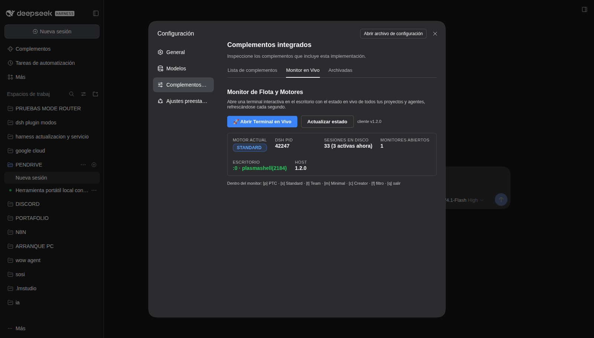
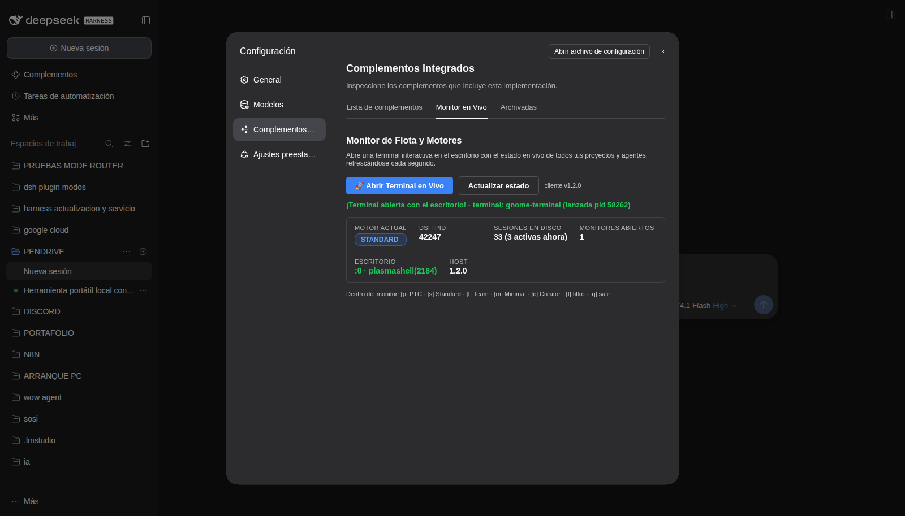

# dsh-plugin-fleet-monitor

Pestaña **Ajustes ▸ Plugins ▸ Monitor en Vivo** en la web de DSH. Un botón abre
una terminal real en el escritorio (GNOME Terminal u otra disponible) ejecutando
`dsh-top`, un monitor que se refresca cada segundo con **todos** los proyectos,
agentes, su modo/preset y su actividad.

```
PROJECT                      AGENT/ID  REAL MODE      STATUS          ACTIVITY
dsh plugin modos             78f9acac  ⚡ STANDARD   🟢 LIVE                0s
PRUEBAS MODE ROUTER          b1ab923d  👥 TEAM       🟢 ACTIVE             20m
dsh plugin modos             092e1755  🛠️ CREATOR    🟡 TODAY               1h
...
```

## Que hace cada mitad

| Pieza | Fichero | Funcion |
| --- | --- | --- |
| Host (cordis) | `lib/index.js` | Rutas `GET /__dsh_fleet/status` y `POST /__dsh_fleet/launch-terminal`. Averigua el entorno grafico real (DISPLAY/Wayland/XAUTHORITY) leyendo el proceso de escritorio y lanza la terminal. |
| Cliente web | `lib/client.js` | Pestana en Ajustes ▸ Plugins, boton de lanzamiento y panel con motor actual, pid de DSH, sesiones en disco/activas, monitores abiertos y escritorio detectado. |
| Monitor | `bin/dsh-top` | Programa Python que se instala en `/usr/local/bin/dsh-top`. |
| Lanzador Web | `bin/dsh-open` | Script Bash que se instala en `/usr/local/bin/dsh-open`: abre la web con el token activo sin chocar en el puerto 3080. |
| Acceso de menú | `share/dsh-web.desktop` | Entrada `.desktop` opcional (`install.sh --desktop`) para abrir DSH Web desde el menú/escritorio. |

`dsh-top` no depende del host: se puede ejecutar a mano (`dsh-top`) en cualquier
terminal. Lee solo la **cabecera** de cada `session.v3/v4.jsonl.zstd`, la cachea por
`(mtime, size)` y deduplica sesiones que existen en v3 y v4.

## Atajos dentro del monitor

| Tecla | Accion |
| --- | --- |
| `p` `s` `t` `m` `c` | pedir conmutacion del motor global (PTC / Standard / Team / Minimal / Creator) y confirmar con `y` (`t` solicita `team` mode) |
| `a` | alternar ver u ocultar subagentes y teammates (`delegationDepth > 0`) |
| `o` | alternar ver u ocultar sesiones huérfanas de workspaces borrados |
| `f` | filtro: todas las sesiones ↔ solo las de las ultimas 24 h |
| `n` / espacio, `b` | pagina siguiente / anterior |
| `r` | descartar la cache y releer cabeceras |
| `q` | salir |

La conmutacion pide confirmacion (`[y]`) para que escribir en la ventana no cambie el motor
por accidente. No mata nada a mano: escribe `~/.dsh/mode-router/request.json` y el
supervisor de motores (`mode-router-real/supervisor.mjs`) hace el cambio con su
patch correspondiente.

## Telemetría de Motor y `real_mode`

`dsh-top` inspecciona la cabecera y el registro de eventos de cada sesión (`agent-preset/selected`):
- Si una sesión o el motor global conmutó a `team`, la columna `REAL MODE` muestra de inmediato `👥 TEAM` en azul brillante (`\033[1;34m`).
- Para los demás motores, renderiza con fidelidad: `⚡ STANDARD`, `⚙️ PTC`, `📟 MINIMAL`, o `🛠️ CREATOR`.
- Esto resuelve de forma definitiva la discrepancia previa en la que las sesiones en `team` figuraban falsamente como `STANDARD`.

## Instalacion

```bash
cd dsh-plugin-fleet-monitor
bash install.sh            # copia el plugin al perfil web + deja /usr/local/bin/{dsh-top,dsh-open}
bash install.sh --desktop  # además instala la entrada de menú ~/.local/share/applications/dsh-web.desktop
bash install.sh --check    # solo comprueba el estado
```

- `--link` enlaza en vez de copiar (comodo mientras se desarrolla, pero el host
  sigue necesitando reinicio).
- `--profile acp` instala en otro perfil.
- `--no-bin` no toca `/usr/local/bin`.
- `--desktop` instala la entrada `dsh-web.desktop` y su icono en `~/.local/share/`.

### Recarga

| Cambio | Como se aplica |
| --- | --- |
| `lib/client.js` | se recarga solo (`dsh-client-hmr`); refresca el navegador |
| `lib/index.js` (host) | **solo** con una importacion nueva: reiniciar `dsh web` o cambiar la ruta fisica del paquete |
| `bin/dsh-top` | inmediato (se lanza un proceso nuevo en cada apertura) |
| `cordis.patch.yml` | en caliente |

Truco de recarga del host SIN reiniciar (el que se uso aqui): Node cachea los modulos
por ruta resuelta, asi que si el paquete estaba enlazado (`node_modules/... -> proyecto`)
basta sustituir el enlace por una copia real y quitar/volver a poner la entrada del
plugin en `cordis.patch.yml`. Eso importa el mismo codigo desde una ruta nueva y el
host nuevo queda vivo en unos segundos. Un reinicio limpio siempre es mas seguro.

Reinicio controlado (respeta el supervisor de motores, no pelea por el puerto):

```bash
bash restart.sh --dry-run   # ver el plan
bash restart.sh             # reinicia y guarda la URL nueva con token
```

Tras reiniciar, la web exige el token nuevo: queda en
`~/.dsh/mode-router/last-url.txt`.

## Como saber que version esta cargada

```bash
curl -s http://127.0.0.1:3080/__dsh_fleet/status
```

La respuesta incluye `"version": "1.2.0"` (campo testigo). Si no aparece, el
proceso sigue con el host anterior: hay que reiniciar. La pestana del navegador
tambien lo avisa en ambar.

## Pruebas

```bash
node tests/test-host.mjs     # rutas, status y lanzamiento REAL de terminal
python3 tests/test-dsh-top.py # paginacion, filtro, conmutacion y salida sobre un pty
```

`tests/test-host.mjs` abre una ventana de terminal de verdad (es la unica forma de
probar el lanzamiento). `tests/test-dsh-top.py` usa un directorio de estado
temporal, asi que no cambia el motor real.

## Problemas conocidos y su causa

| Sintoma | Causa | Solucion |
| --- | --- | --- |
| El boton responde `ok` pero no aparece ventana | `dsh web` corre sin sesion grafica (p. ej. unidad systemd) y no habia terminar | El host copia el entorno de `plasmashell`/`nemo`; si aun asi falla, revisa `desktop` en `/status` |
| `{"ok":true,"server":"dsh-fleet-monitor"}` sin `version` | host antiguo cacheado | reinicia dsh web |
| La pestana no aparece | falta la entrada en `cordis.patch.yml` o falta el paquete en `node_modules` | `bash install.sh` |
| Las sesiones `v3` no salian | el monitor antiguo solo leia `session.v4` | corregido en v1.2 (glob `session.v*.zstd` + dedupe) |
| Aparecen sesiones duplicadas | la misma sesion existe como v3 y v4 | corregido en v1.2 (dedupe por id, gana la copia mas reciente) |

## Estado verificado (2026-11-10)

Comprobado sobre el `dsh web` real (puerto 3080) y sobre la UI con Chrome headless:

- Pestana en **Configuracion ▸ Complementos integrados ▸ Monitor en Vivo**, con motor
  actual, pid de DSH, sesiones en disco/activas, monitores abiertos, escritorio
  detectado y versiones de host y cliente.

  

- Pulsar **Abrir Terminal en Vivo** abre GNOME Terminal con `dsh-top` en el escritorio
  (sesion KDE Plasma/Wayland) y responde con la terminal y el pid usados.

  

- `GET /__dsh_fleet/status` → `"version": "1.2.0"` (campo testigo).
- `POST /__dsh_fleet/launch-terminal` → `{ ok: true, terminal: "gnome-terminal", pid }`.
- `dsh-top` v1.2 lee 30 sesiones unicas en este equipo (antes 17: se perdian las v3,
  y las que existen como v3+v4 salian duplicadas).
- `tests/test-host.mjs` y `tests/test-dsh-top.py` en verde.

## Subagentes: las sesiones hijas no son conversaciones

Cada vez que un agente delega en otro (Team, PTC, `subagent`), DSH crea una sesión
hija con `delegationDepth > 0` y `parentSession` apuntando a la conversación que la
lanzó. Esas sesiones aparecen en el mismo workspace y con el preset del padre, así
que parecían "conversaciones de más".

- Por defecto el monitor **oculta** las sesiones con `delegationDepth > 0`.
- `[a]` alterna verlas u ocultarlas.
- La cabecera separa `N conversaciones + M subagentes` y el pie dice cuántos están ocultos.

### Teammates nativos (`team` mode) vs Subagentes legacy
En `team` mode, los compañeros de equipo creados mediante `spawn_teammate` son procesos pares persistentes que reciben su nombre asignado (`explorer`, `implementer`, etc.) y quedan vinculados al workspace del Lead. A diferencia de las sesiones hijas efímeras, los teammates gestionan tareas compartidas mediante la pizarra CAS y buzones tipados.

## Proyectos borrados: sesiones huérfanas

Al borrar un proyecto en DSH, sus ficheros de sesión **siguen en disco** pero dejan de
colgar de un workspace activo (`global.workspaceIds` en `~/.dsh/storages/workspace.json`).
El monitor las detecta cruzando el registro con el disco:

- Las marca como **huérfanas** y las oculta por defecto (la sesión EN VIVO siempre se ve).
- `[o]` alterna mostrarlas u ocultarlas.
- La cabecera las cuenta aparte: `12 conversaciones + 15 subagentes + 3 huérfanas`.
- Si `workspace.json` no se puede leer, no se filtra nada (mejor enseñar de más que de menos).

## Auto-wakeup (conmutación que continúa sola)

El supervisor de motores (`mode-router-real/supervisor.mjs`) para `dsh web`, lo relanza
con el patch del motor nuevo y, cuando el puerto responde, pide al plugin que despierte
la sesión que originó el cambio:

```
POST /__dsh_fleet/wake
{ "sessionId": "session-…", "mode": "ptc", "reason": "texto de la tarea" }
→ 200 { "ok": true, "awakened": "session-…", "mode": "ptc" }
```

El plugin inyecta un prompt de tipo `user` con:

```
[SISTEMA]: Motor conmutado con éxito a <modo>. La sesión se ha reanudado en caliente.
Continúa de inmediato con tu tarea: <motivo>
```

Así el agente despierta con la tarea delante y sin que el humano escriba nada.
Requiere que el host tenga el servicio `sessionController` inyectado.

Pruebas: `node tests/test-wake.mjs` (prompt con modo, JSON, 400 sin sessionId, 405 en GET).

## Idioma

La ventana del monitor (`dsh-top`) esta **en ingles** (PROJECT / AGENT-ID / REAL MODE /
STATUS / ACTIVITY, LIVE / ACTIVE / TODAY / resting / inactive, y los pies en ingles).

La pestana web del plugin sigue el idioma de la interfaz de DSH (diccionarios es/en en
`lib/client.js`): si DSH esta en espanol, la pestana sale en espanol.
